<p align="center">
<a href="https://github.com/neonspectra/epcc">
    
</a>
</p>


# EPCC – Eclipse Phase 1E Character Creator

This repo is a fork of the [original web-based character creator application](https://github.com/Eclipse-Phase-Unofficial/ep-character-creator) for the [Eclipse Phase First Edition (1E)](https://posthuman.shop/products/eclipse-phase-first-edition-pdf) role-playing game, because I prefer Eclipse Phase 1E over the newer Second Edition. 

While I think that Posthuman Studios are a great team ([support them and buy their stuff!](https://posthuman.shop/)), Eclipse Phase has always had a problem of not really knowing what it wants to be. Although the second edition is more streamlined, I think Eclipse Phase 2E really lost sight of its roots as a simulationist game system focused on accurately and consistently depicting the minutiae of how its hard-scifi setting works.

The original upstream EPCC repo is no longer maintained, so I forked it to bring it up to date (so that it can be built automatically with modern CI), make tweaks to improve it, and preserve it for those of us still playing Eclipse Phase 1E.

---

## Contents
* [Source](https://github.com/neonspectra/epcc)
* [Releases](https://github.com/neonspectra/epcc/releases)
* [Issues](https://github.com/neonspectra/epcc/issues)
* Websites that Host EPCC
    * [epcc.neosynth.net](https://epcc.neosynth.net)
    * [epcc.onrender.com](https://epcc.onrender.com) (*Mirror, has delayed startup on inactivity*)

## License
This work is licensed under the **Creative Commons Attribution-NonCommercial-ShareAlike 4.0 International License**.

You can read the full license description [here](https://github.com/neonspectra/epcc/blob/main/LICENSE.txt).

## Authors
See [here](https://github.com/neonspectra/epcc/blob/main/Authors.md) for a list of everyone who has contributed to this project.

## Version
The current version is **2.02 (Argonaut)**. See the [Changelog](https://github.com/neonspectra/epcc/blob/main/CHANGELOG.md).

## EPCC Configuration
Application defaults live in [`config/`](config/), with EPCC-specific settings in
[`config/epcc.php`](config/epcc.php). Laravel environment variables can override
those defaults; pass a custom env file to Docker with `--env-file custom.env`.

Release identity has two deliberately separate sets of variables:

- `EPCC_VERSION_NAME` and `EPCC_VERSION_NUMBER` are canonical compatibility
  metadata written into exported character saves (currently `Argonaut` and
  numeric `2.02`).
- `EPCC_BUILD_COMMIT` records the source commit in exported saves.
- `EPCC_DISPLAY_VERSION`, `EPCC_DISPLAY_VERSION_NAME`,
  `EPCC_DISPLAY_COMMIT`, and `EPCC_DISPLAY_RELEASE_DATE` describe the running
  build through `GET /api/version`. Nightly display values may identify a Git
  commit without changing the numeric save compatibility version.

Eclipse Phase content is stored in the database. A full SQL dump is available
at [`database/database.sql`](database/database.sql).

## Running via Docker
Docker is the recommended, and only officially supported method or running this app.
While the setup steps below can be used for development, it is **highly recommended** that deployment be done via Docker.

### Building from Source
The following command builds a deployment-ready image and refreshes the
floating PHP 8.4 base to its latest patch. If your user is not in the `docker`
group, you may need `sudo`.
```bash
docker image build --pull --tag epcc .
```

The build fails if the resolved PHP runtime is older than 8.4.27, the first PHP
8.4 release that fixes CVE-2026-109618 and CVE-2026-109619.

### Obtaining from ghcr.io
If you don't want to build your own docker image, you can pull it from this repo's GitHub Container Registry [here](https://github.com/neonspectra/epcc/pkgs/container/epcc).

#### Tags we support:
- `ghcr.io/neonspectra/epcc:nightly` - Latest nightly (built off the latest change in `main`)
- `ghcr.io/neonspectra/epcc:latest` - Latest stable release version
- `ghcr.io/neonspectra/epcc:sha-XXXX` - Pin a nightly based off its SHA commit hash
- `ghcr.io/neonspectra/epcc:vXXXXX` - Pin a specific stable release version with its version tag.
    - *Note that we don't have any pre-fork builds of the image. Please visit the [original project](https://github.com/Eclipse-Phase-Unofficial/ep-character-creator) if you want an older image.*

### Running
In most cases the following command will allow you to test the build image locally.
It exposes a webserver on port 8080 that you can access to view the container. You can test access locally by navigating to [http://localhost:8080](http://localhost:8080).
```bash
sudo docker run --rm -it -p 8080:80 --name epcc epcc
```

If deploying to the internet, you may want to consider using your own '.env' file.
Doing so allows you to change things like the error reporting location, or almost any other configuration.
Simply add `--env-file custom.env` to the run command above.

#### Optional health check
For troubleshooting, you can run a health check:
```bash
sudo docker inspect --format='{{json .State.Health}}' epcc
```

##  Local Development and Testing
You will need:

* [PHP 8.4.27 or greater](https://php.net)
* [node 24 LTS](https://nodejs.org/)
* [composer 2.x](https://getcomposer.org/)
* Either: [mySql 14.14 or greater](https://dev.mysql.com/downloads/)
* Or: [sqlite3](https://www.sqlite.org/download.html) (Recommended)

### Database Setup
#### SQLite:
1. Create a sqlite3 database
    ```bash
    sed 's/\\n/ /g' database.sql > tmp.sql
    sqlite3 --init tmp.sql database.sqlite
    ```
3. Copy `standalone.env` to `.env`.

#### MySql
1. create a MySql database
    ```mySql
    CREATE USER 'epcc_www'@'localhost' IDENTIFIED BY '$DATABASE_PASSWORD';
    GRANT ALL PRIVILEGES ON EclipsePhaseData.* TO 'epcc_www'@'localhost' WITH GRANT OPTION;
    CREATE DATABASE EclipsePhaseData;
    USE EclipsePhaseData;
    ```
2. Import the database
    ```
    mysql -h localhost -u epcc_www -p'$DATABASE_PASSWORD' EclipsePhaseData < database/database.sql
    ```
3. Configure database access in your custom `.env` file.  
See [here](https://laravel.com/docs/12.x/database#configuration) for how to do that.

### Saving database changes
#### SQLite:
To save changes made to the Sqlite database run:
```bash
echo -e ".once database.sql\n.dump"|sqlite3 database.sqlite
```
WARNING:  If you use this feature, skip the `sed` step when creating the database.

### Using the built in php web server
1. Set up the database.
2. From a command prompt in the top level of this project run `php artisan serve`
3. Browse to http://localhost:8080

### Running the test suite (PHPUnit)
```bash
composer install
php artisan test
```

Pull requests also build the Docker image from a refreshed base and smoke-test
the PHP security floor, homepage, health check, `/api/version`, and exported
save metadata. Stable releases are dispatched through the **Release Image**
workflow, which tests, builds and verifies both architectures before publishing
`vX.XX`/`latest` and creating the matching Git tag and GitHub Release.
